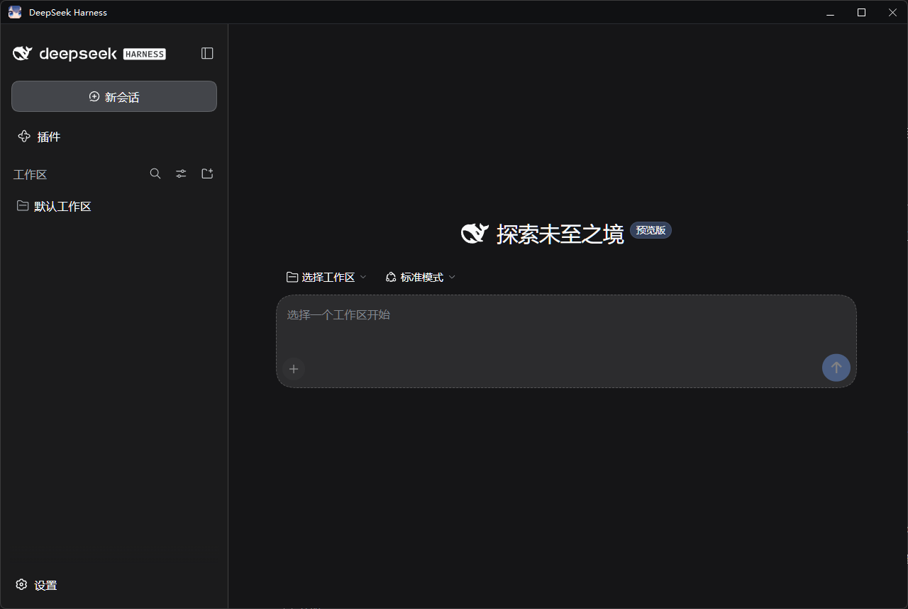

# DshShell · DeepSeek Harness 桌面外壳

> 纯粹的dsh套壳。起因是桌面端和Web端经常有一些插件不互通，文件保存位置不同之类的问题。所以给自己做了个dsh外壳，内核还是web。**。
> 只有一个 **260 KB 的 exe，单纯的web端外壳。使用起来就是web端的习惯**。




---

## 这是什么

DeepSeek Harness（下称 DSH）本身是个本地 Web 应用：要开终端敲 `dsh web`，再把打印出来的**带 token 的地址**贴进浏览器，用起来像"临时网页"。

DshShell 把它变成一个有自己图标的桌面程序：

- 双击桌面图标 → 后台拉起 `dsh web` → 解析出带 token 的 URL → 用 WebView2 把界面装进自己的窗口
- 窗口是**系统原生标题栏**（最小化 / 最大化 / 双击最大化 / 贴靠布局 / 系统菜单都有），配深色标题栏与 Win11 圆角
- 托盘图标常驻，关窗口默认收进托盘；**退出前有确认**，不会手滑把正在跑的任务关掉

页面里跑的仍然是你熟悉的那个 DSH：会话、工作区、插件、设置都在 `~\.dsh`，和命令行 `dsh web` 完全共享。

## 特性

| | |
|---|---|
| 🖱️ **双击即开** | 桌面 / 开始菜单 / 任务栏固定都行；重复双击不会开第二个进程，只把已有窗口拉到前台 |
| 📌 **独立任务栏图标** | 窗口由本进程创建，任务栏条目和分组都归 DshShell，不蹭 Edge/Chrome 的图标 |
| 📥 **可隐藏** | 托盘常驻；左键单击切换显示/隐藏，`Ctrl+Alt+D` 全局热键，点最小化可按配置收进托盘 |
| ❓ **关闭时询问** | 可选「最小化到托盘 / 退出 DSH / 取消」三分支；也可以改成"直接收托盘"或"直接退出" |
| 🔄 **服务托管** | 自动探测 DSH 的启动方式、拉起服务、解析 token URL；服务意外退出自动重启（最多 5 次退避）；退出时整棵进程树一起收掉 |
| 🧩 **宿主可切换** | WebView2（默认）/ Edge `--app` / Chrome `--app`，托盘菜单里直接切 |
| 🎛️ **零配置可用** | 装完就能跑；端口随机避免冲突，配置全在一个 JSON 里 |
| 🪶 **极轻** | 260 KB exe + 约 930 KB WebView2 互操作 DLL，没有运行时捆绑，也没有 Electron |

## 安装

### 方式一：下载安装包（推荐）

1. 下载 `dist/DshShell-x.y.z-win-x64.zip`（仓库里就是现成的；有 [Releases](../../releases) 的话也可以从那里下）
2. **完整解压**到一个普通目录（不要放在 DSH 的工作区里，原因见下方[常见问题](#faq)）
3. 双击 **`install.cmd`**

安装脚本会把程序装到 `%LOCALAPPDATA%\Programs\DshShell`，解除文件的"来自 Internet"标记（避免每次启动弹 SmartScreen），并创建桌面与开始菜单快捷方式。

> 也可以手动执行：`powershell -ExecutionPolicy Bypass -File install.ps1`，加 `-Start` 装完直接启动。

### 方式二：从源码编译

```powershell
git clone https://github.com/Cre5cendo/dsh-shell.git
cd dsh-shell
pwsh -File tools\build.ps1 -Install
```

只依赖 Windows 自带的 .NET Framework 编译器（`csc.exe`），首次编译会自动下载 WebView2 SDK。

## 前置条件

| 依赖 | 说明 |
|---|---|
| Windows 10 1809+ / Windows 11（x64） | |
| .NET Framework 4.8 | Windows 10 1903+ 与 Windows 11 自带 |
| WebView2 运行时 | Win11 自带；Win10 一般随 Edge 自带。缺失时自动退回 Edge 窗口模式，功能不完整。[下载](https://developer.microsoft.com/microsoft-edge/webview2/) |
| DSH | Node.js 22+ 后 `npx @deepseek-ai/dsh`；或已用 DSH 管理器装好（`%APPDATA%\DSH\data\.bin\dsh.cmd`） |

## 使用

**托盘图标**

- 左键单击：显示 / 隐藏窗口
- 右键：菜单 —— `浏览器打开` · `重新加载` · `重启服务` · `自绘窗口` / `Edge 窗口` / `Chrome 窗口`（三选一打勾）· `开机自启` · `服务日志` · `退出`

**窗口**

- 点 `×`：默认收进托盘（配置项 `CloseAction`）
- 最小化：默认留在任务栏（`MinimizeToTray: false`），可在配置里改成收进托盘
- `Ctrl+Alt+D`：显示 / 隐藏
- 退出：托盘菜单 → `退出`；退出时默认连同 DSH 服务一起停掉（`QuitStopsServer`）

**开机自启**：托盘菜单勾选「开机自启」即可，写 `HKCU\...\Run`，带 `--minimized` 静默进托盘，不需要管理员权限。

## 配置

配置文件：`%LOCALAPPDATA%\Programs\DshShell\config.json`（源码构建时是 `app\config.json`）。

| 字段 | 默认 | 说明 |
|---|---|---|
| `Host` | `auto` | 宿主引擎：`auto`（优先 WebView2，缺失时回退 Edge/Chrome）、`webview2`、`edge`、`chrome` |
| `Port` | `0` | DSH 服务端口。`0` = 系统随机分配，**不会和你手动开的 DSH 抢端口**；想固定就填具体数字 |
| `DshCommand` | `""` | 留空自动探测（见下）；也可写死，如 `C:\Program Files\nodejs\node.exe` |
| `CloseAction` | `tray` | 点 × 的行为：`tray` 收托盘 / `ask` 询问 / `quit` 直接退出 |
| `QuitStopsServer` | `true` | 退出外壳时是否顺带停掉自己拉起的 DSH 服务 |
| `MinimizeToTray` | `false` | 最小化时隐藏到托盘 |
| `AutoRestartServer` | `true` | 服务意外退出时自动重启 |
| `GlobalHotkey` | `Ctrl+Alt+D` | 显示/隐藏热键，留空禁用 |
| `StartMinimized` | `false` | 启动后直接进托盘 |
| `WindowWidth/Height/X/Y/Maximized` | — | 窗口尺寸位置，退出时自动记住 |
| `DevTools` | `false` | WebView2 里按 F12 打开开发者工具 |

## 工作原理

```text
  双击快捷方式
        │
        ▼
  DshShell.exe ──单实例互斥锁──> 已有实例？只把窗口拉到前台
        │
        ├─ 1. 找 dsh：%APPDATA%\DSH\data\.bin\dsh.cmd → PATH → npx 缓存 → npx -y @deepseek-ai/dsh
        ├─ 2. 写 data\launch-server.cmd 并 cmd /c 启动：
        │        dsh web --no-open --port 0   >  data\logs\server-<时间>.log  2>&1
        ├─ 3. 盯日志，正则匹配 `dsh web: <url>` 拿到本轮带 token 的地址
        ├─ 4. WebView2（独立 profile：data\profile\webview2）导航到该 URL
        └─ 5. 退出时 taskkill /T /F 收掉整棵服务进程树
```

**为什么非要自己拉起服务？** 直接访问 `http://127.0.0.1:3080` 会返回
`401 dsh web authentication required; reopen the URL printed by dsh web` ——
带 token 的地址只在 `dsh web` 启动时打印**一次**。所以外壳必须自己拉起服务、从输出里解析那一行。

这也是为什么每次启动**端口和 token 都会变**：`--port 0` 让系统分配空闲端口，token 每个进程重新生成。两个 DSH 实例可以同时运行，会话数据共享 `~\.dsh`。

## 为什么是 WebView2 而不是 Electron

| | DshShell | Electron 方案 |
|---|---|---|
| 体积 | ~1.2 MB | 100 MB+ |
| 运行时 | 复用系统 Edge 内核，无需捆绑 | 捆绑 Chromium + Node |
| 能拦截关闭按钮 | ✅ 窗口是本进程的 | ✅ |
| 需要构建环境 | 只要 Windows 自带的 csc.exe | Node + 下载 Electron（网络不稳时很痛苦） |

代价是 Windows 独占、依赖系统 WebView2 运行时。

## 从源码构建

```powershell
pwsh -File tools\build.ps1              # 编译到 app\
pwsh -File tools\build.ps1 -Install     # 编译 + 安装到 %LOCALAPPDATA%\Programs\DshShell
pwsh -File tools\build.ps1 -Release     # 编译 + 打包 dist\DshShell-<版本>-win-x64.zip
pwsh -File tools\build.ps1 -Install -Sign  # 顺便自签名（需管理员，仅本机信任）
```

| 脚本 | 作用 |
|---|---|
| `tools\build.ps1` | 下载 WebView2 SDK → 生成图标 → 编译 → 组装 `app\` →（可选）安装 / 打包 |
| `install.ps1` / `install.cmd` | 安装到 `%LOCALAPPDATA%`、解除网络标记、建快捷方式 |
| `uninstall.ps1` / `uninstall.cmd` | 卸载 |
| `tools\make-icon.ps1` | 用 `assets\source-icon.png` 生成多尺寸 `icon.ico`（16–256，BMP 条目 + 圆角） |
| `tools\sign.ps1` | 自签名并让本机信任（`-Remove` 撤销） |

## 目录结构

```text
dsh-shell/
  src/                 C# 源码（WinForms + WebView2）
    Program.cs           入口、单实例、--selftest
    ShellApp.cs          托盘、热键、菜单、配置持久化
    ShellWindow.cs       主窗口（原生标题栏、深色标题、WebView2 宿主）
    BrowserHost.cs       三选一宿主引擎
    DshServer.cs         拉起/托管 dsh 进程、解析 token URL
    ShellConfig.cs       config.json / state.json 模型
    DarkMenu.cs          深色菜单渲染
    CloseDialog.cs       关闭询问框
    Native.cs            Win32 互操作
  tools/               构建脚本
  assets/              icon.ico（附源图 source-icon.png）
  docs/                截图
  install.ps1 / .cmd   安装
  uninstall.ps1 / .cmd 卸载
  config.json          配置模板
```

运行期数据都在安装目录的 `data\`：`logs\shell.log`（外壳步骤）、`logs\server-*.log`（DSH 原始输出）、`profile\`（WebView2 独立 profile）。

## FAQ

### 启动时提示"Windows 已保护你的电脑"/未知发布者？

exe 是**未签名**的。`install.ps1` 已经对装好的文件做了 `Unblock-File`，正常情况下不会再提示。如果仍然提示：

- 右键 exe → 属性 → 勾选「解除锁定」→ 确定
- 或点「更多信息」→「仍要运行」
- 想彻底避免：用 `tools\build.ps1 -Install -Sign` 在本机自签名（只对你自己的机器有效，别人的机器不会信任这张证书）

### 托盘里找不到图标？

1. Win11 会把**新出现的图标收进 `^` 溢出区**，点开找一下，可以拖到任务栏固定
2. **不要把 exe 放在 DSH 的工作区目录里**。DSH 会给工作区打「低完整性级别」标记，低完整性进程不允许注册托盘图标（`Shell_NotifyIcon` 返回错误 5），还会被 Windows 当成不可信程序弹「安全警告」。安装脚本会把程序复制到 `%LOCALAPPDATA%\Programs\DshShell` 正是为了避开这个坑。

### 提示"找不到 dsh"？

DshShell 按顺序探测：`%APPDATA%\DSH\data\.bin\dsh.cmd` → PATH 上的 `dsh` → npx 缓存 → `npx -y @deepseek-ai/dsh`。都没有时：

```powershell
# 装 Node.js 22+ 后二选一
npm i -g @deepseek-ai/dsh      # 装到 PATH
npx @deepseek-ai/dsh --version # 或者交给 npx
```

也可以直接写死：`"DshCommand": "C:\\Program Files\\nodejs\\node.exe"`（配合 `DshCommand` 指向 `bin.js` 时外壳会自动补 node）。

### 每次启动端口都不一样，正常吗？

正常，故意的。`Port: 0` → 系统随机分配空闲端口，好处是**永远不会和你手动开的 `dsh web`（通常 3080）冲突**，两个实例可以并存。想固定就改成具体端口号。

### 和官方的 DSH 桌面版冲突吗？

不冲突。这是两个独立程序，共享 `~\.dsh` 里的会话和工作区数据。你可以只留一个。

### 杀毒软件报毒？

260 KB 的未签名程序容易触发启发式误报。源代码全在 `src/`，可以自己编译（自己编译出来的不会被拦）。介意的话把安装目录加进白名单。

### 二次开发

界面就是 DSH 自己的 Web UI，外壳只负责窗口和服务生命周期。想改外观改 DSH；想改窗口行为改 `ShellWindow.cs` / `ShellApp.cs`。

## 卸载

双击 `uninstall.cmd`，或：

```powershell
powershell -ExecutionPolicy Bypass -File uninstall.ps1
```

会停进程、移除开机自启、删除快捷方式和安装目录。**不会**动 DSH 本身，也不会动 `~\.dsh` 里的会话数据。

## License

[MIT](LICENSE)。WebView2 运行时程序集来自 Microsoft 的 WebView2 SDK，遵循其自身许可；本项目不捆绑 DSH 本体。

---

## English

A tiny Windows shell for **DeepSeek Harness**: a 260 KB WinForms executable that launches `dsh web`, parses the one-time tokenized URL from its output, and embeds the page in a native window with WebView2 — own taskbar entry, tray icon, hide-to-tray, and a confirm-on-close dialog. No Electron, no bundled runtime, no .NET SDK required (uses the compiler that ships with Windows).

```powershell
# install from a release zip
.\install.cmd        # or: powershell -ExecutionPolicy Bypass -File install.ps1

# build from source
pwsh -File tools\build.ps1 -Install
```

Requirements: Windows 10 1809+/11 x64, .NET Framework 4.8, WebView2 Runtime (bundled with Win11 / Edge), and DSH available via `npx @deepseek-ai/dsh` or a DSH install. Licensed under MIT.
